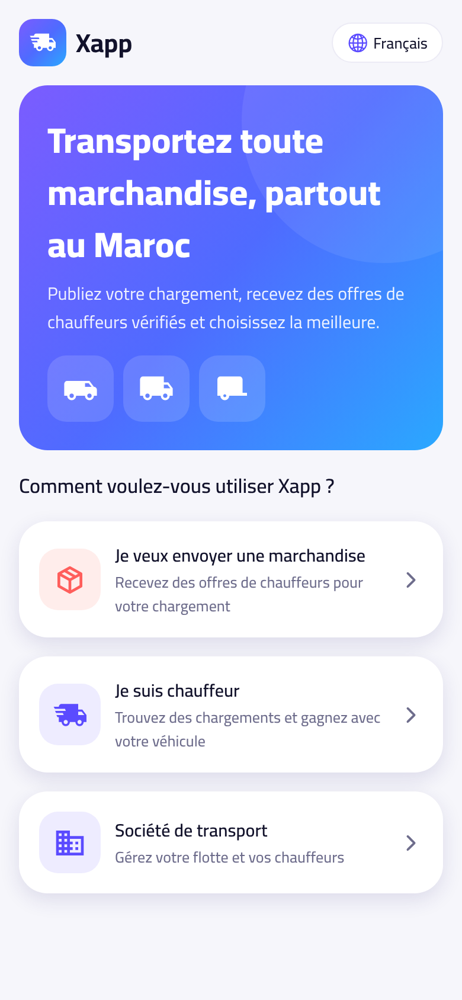
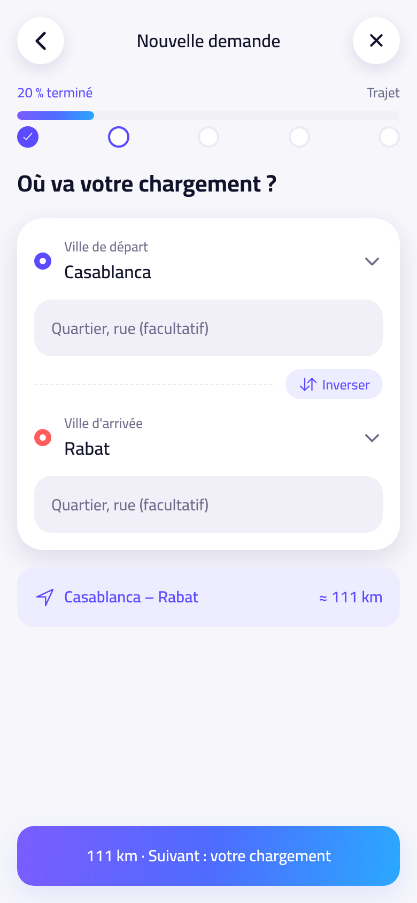
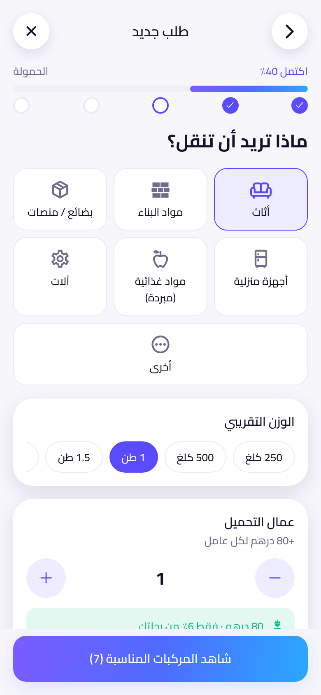
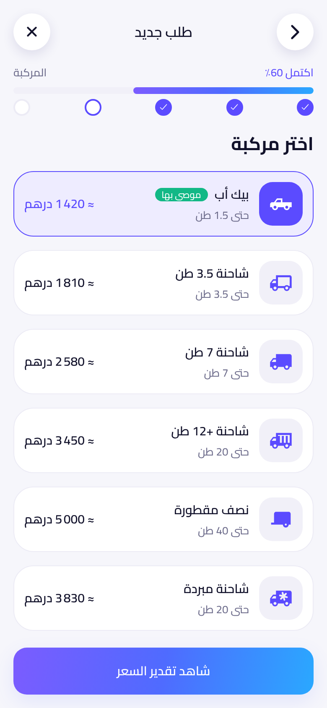
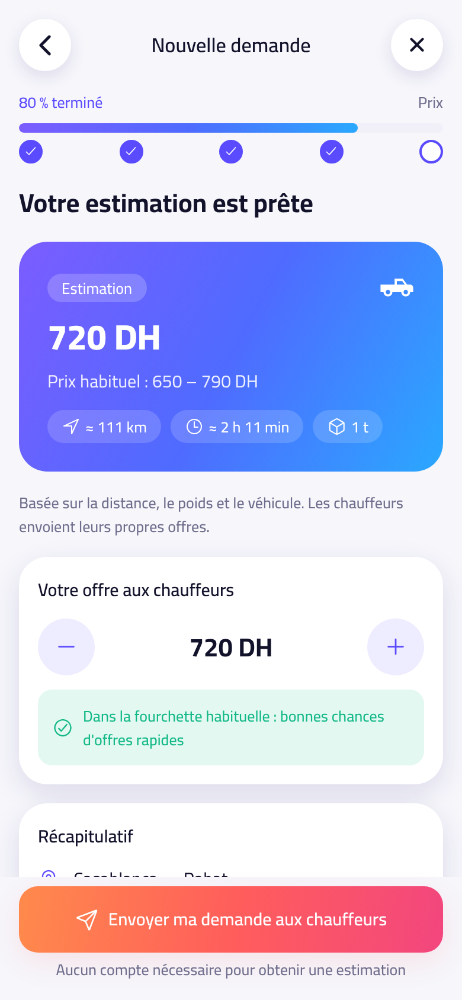
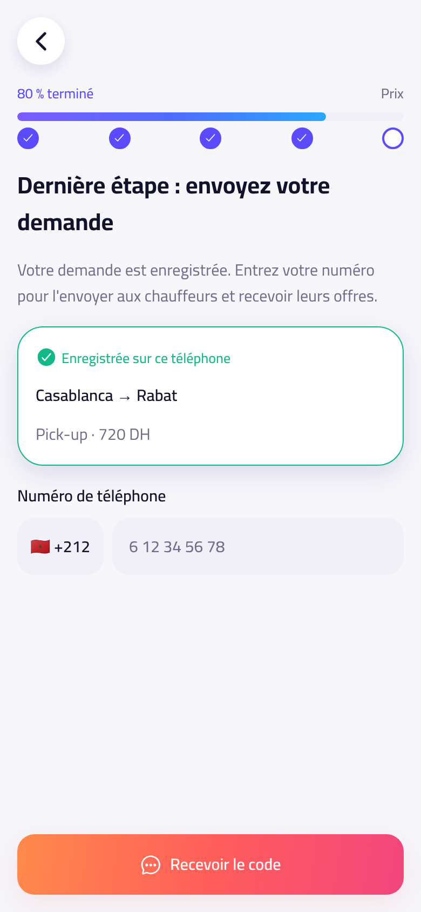
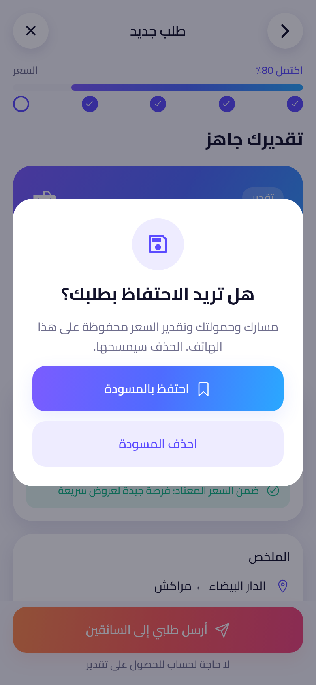
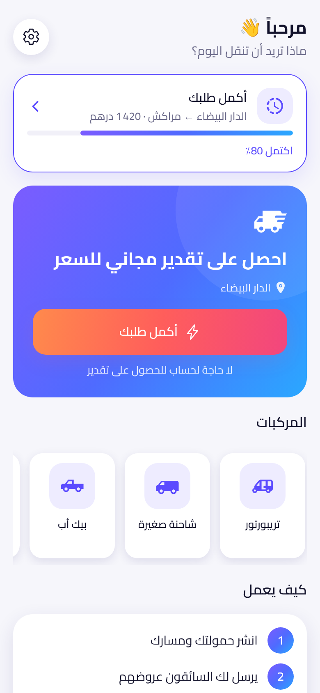

# Xapp

Freight delivery marketplace for Morocco: clients post a load, drivers send offers, the client picks one.
Available in Arabic, French and English.

See [docs/PLAN.md](docs/PLAN.md) for the full plan and [docs/UX_PRINCIPLES.md](docs/UX_PRINCIPLES.md) for the UX rules every screen follows.

## Structure

```
apps/mobile   – phone app for Android and iPhone (React Native + Expo)
apps/admin    – admin web panel (coming later)
docs/         – plan and documentation
```

## Run the phone app

```bash
cd apps/mobile
npm install
npx expo start        # scan the QR code with the Expo Go app on your phone
npx expo start --web  # or open it in the browser
```

Checks:

```bash
npm run typecheck
npm run lint
npm test
```

## Screenshots

| Welcome | Route (step 1) | Load (Arabic) | Vehicle (Arabic) |
|---|---|---|---|
|  |  |  |  |

| Price estimate | Sign-up after estimate | Keep draft? (Arabic) | Resume draft (Arabic) |
|---|---|---|---|
|  |  |  |  |
